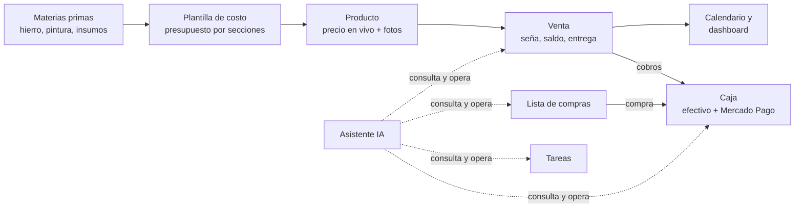
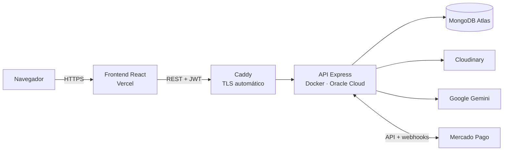

# Costify — BackEnd

> **Sistema de gestión para talleres que fabrican a medida.** Calcula el costo y el precio de venta de cada trabajo, sigue cada venta desde la seña hasta la entrega, controla la plata del negocio y suma un **asistente de IA** que consulta y opera sobre los datos reales.
>
> Este repositorio es la **API REST** (Node.js · Express · MongoDB). El frontend está en [Costify-FronEnd](https://github.com/SebaGarea/Costify-FronEnd).


[](https://costify.duckdns.org/api-docs)


**📚 Documentación de la API en vivo:** [costify.duckdns.org/api-docs](https://costify.duckdns.org/api-docs) · **🖥️ App:** [elportalherreria.vercel.app](https://elportalherreria.vercel.app) (acceso por invitación)

---

## 🧭 ¿Qué es Costify?

Costify nació para resolver un problema real de **El Portal — Herrería Artística**, un taller de herrería y carpintería a medida. Cada trabajo es distinto, los precios del hierro y la pintura cambian seguido y parte de las ventas sale por Mercado Libre, con comisiones que hay que contemplar al poner precio.

Hoy el taller usa Costify **en producción** para:

| Necesidad del taller | Cómo lo resuelve Costify |
|---|---|
| "¿Cuánto cobro este portón?" | **Plantillas de costo**: se cargan materiales, consumibles, pintura y mano de obra, y calcula costo, ganancia y precio final, también **por plataforma** (Mercado Libre, Tienda Nube) con sus comisiones. |
| "Subió el hierro, ¿quedaron viejos los precios?" | El precio de cada producto se **recalcula en vivo** desde su plantilla y los precios de las materias primas. |
| "¿Qué hay que entregar esta semana? ¿Quién debe plata?" | **Ventas** con seña, saldo, estados y fecha de entrega, más un **calendario** y un **dashboard** con atrasos y pendientes. |
| "¿Cuánta plata tenemos y en qué se fue?" | **Caja**: efectivo y Mercado Pago, gastos por categoría, plata **a liberar** de Mercado Libre y **retiros de cada socio**. |
| "¿Qué hay que comprar?" | **Lista de compras** por sección, que al marcar "comprado" descuenta el gasto de la Caja. |
| "No tengo tiempo de navegar pantallas" | **Asistente de IA**: "¿qué entregas tengo mañana?", "anotá un gasto de 20.000 en combustible", "registrá un cobro de Juan". |

---

## 🔄 Flujo de trabajo



---

## 🚀 Funcionalidades

### 💲 Costos y precios
- **Materias primas**: categorías, tipos, medidas, stock y precio. Se pueden importar en masa desde Excel.
- **Plantillas de costo**: presupuestos por secciones (herrería, carpintería, pintura, otros) con materiales, consumibles, extras y porcentaje de ganancia. Admiten **adjuntos** (PDF e imágenes en Cloudinary) y comentarios.
- **Cálculo de pintura por perfil**: cada perfil de hierro (cuadrado, redondo, planchuela, L…) tiene su perímetro, así que la superficie a pintar sale sola de los metros usados. Hay un precio global que se aplica a todas las plantillas de una vez.
- **Precios por plataforma**: Mercado Libre (planes con cuotas) y Tienda Nube, con sus comisiones.

### 🧾 Ventas y producción
- **Productos**: catálogo vinculado a su plantilla, con imágenes en Cloudinary y stock.
- **Ventas**: estados (pendiente, en proceso, finalizada, despachada, cancelada), seña, saldo, cliente, medio de venta, fecha de entrega y una **foto del precio y los materiales** al momento de la venta.
- **Tareas y calendario**: recordatorios con prioridad, vencimiento y etiquetas, más eventos manuales para la vista unificada.

### 💰 Caja (control de dinero)
- **Cuentas**: efectivo, Mercado Pago y otras billeteras. El saldo se **calcula** a partir de los movimientos en lugar de guardarse, así nunca se desincroniza.
- **Movimientos**: ingresos, gastos y transferencias, con categorías. Se pueden filtrar y exportar a Excel.
- **"Ajustar saldo"**: lleva el saldo calculado al valor real y deja registrado el ajuste.
- **Disponible vs. a liberar**: separa la plata de Mercado Libre que todavía no se liberó.
- **Retiros de socios**: cuánto retiró cada socio en el período.
- **Integración con Mercado Pago** (pausable): importa cobros y pagos por webhook con firma HMAC verificada y con una sincronización periódica, sin duplicados.

### 🤖 Asistente de IA
- Chat con **streaming** sobre **Google Gemini** con **tool-calling**.
- **Herramientas de lectura**: métricas, entregas próximas, productos, stock bajo, márgenes, comparación mensual, caja, clima, dólar y búsqueda web.
- **Herramientas de escritura**: tareas, cobros, entregas, ventas, productos, lista de compras y movimientos de caja. Pide confirmación antes de las acciones importantes.
- **Contexto real**: un resumen del negocio, la fecha de Argentina y el perfil del negocio se inyectan en cada consulta.
- **Robusto**:
  - historial guardado en el servidor;
  - resumen diario que no consume cuota de IA;
  - límite de pedidos;
  - modelo de respaldo con reintentos.

---

## 🔐 Seguridad

La autenticación pasó por una auditoría completa:

- **Passport** con login local, **JWT** firmado con HS256 (algoritmo fijo) y **Google OAuth 2.0**.
- **Google OAuth** con `state` firmado y una cookie httpOnly contra CSRF. El token **nunca viaja en la URL**: se canjea un código de un solo uso que dura 60 segundos. Solo se aceptan emails verificados por Google.
- **Autorización por rol**: solo un admin administra usuarios. El registro es **solo por invitación**.
- **Contraseñas**:
  - bcrypt con costo 12;
  - comparación en tiempo constante, para no revelar qué emails existen;
  - cambiar la contraseña **invalida las demás sesiones**.
- **Rate limiting por IP real** (detrás del proxy) en el login, el registro y el chat de IA.
- **Helmet** y **CORS** con lista de orígenes permitidos; **express-validator** en todas las entradas.
- **Secretos** solo en variables de entorno. El servidor avisa si `JWT_SECRET` es débil.

---

## 🛠️ Tecnologías

| Categoría | Stack |
|---|---|
| **Core** | Node.js, Express 5, MongoDB, Mongoose |
| **IA** | Google Gemini (`@google/generative-ai`) con tool-calling y streaming |
| **Auth** | Passport (local, JWT, Google OAuth 2.0), bcrypt |
| **Pagos** | API de Mercado Pago + webhooks firmados (HMAC-SHA256) |
| **Archivos** | Cloudinary, Multer |
| **Seguridad** | Helmet, express-rate-limit, express-validator |
| **Docs** | Swagger / OpenAPI (`swagger-jsdoc`, `swagger-ui-express`) |
| **Logging / Email** | Winston, Nodemailer |
| **Excel** | xlsx (importación de materias primas) |
| **Testing** | Mocha, Chai, Sinon, Supertest |
| **Infra** | Docker, Caddy (HTTPS automático), Oracle Cloud |

---

## 🏗️ Arquitectura



El código sigue capas bien separadas: **Router → Middlewares (auth, validación) → Controller → Service → DAO → Modelo Mongoose**.

```
src/
├── app.js / server.js     # configuración de Express y arranque
├── config/                # passport, logger, variables
├── routes/                # routers REST por entidad
├── middlewares/           # auth por rol, validaciones, manejo de errores
├── controllers/           # adaptan HTTP ↔ servicios
├── services/              # lógica de negocio (caja, ventas, IA, herramientas, Mercado Pago…)
├── dao/                   # acceso a datos y modelos Mongoose
├── docs/                  # definiciones Swagger
└── utils/
deploy/                    # docker-compose de producción, Caddyfile y guía de despliegue
test/                      # unitarios e integración
```

---

## 📑 Endpoints principales

Detalle completo, con parámetros y respuestas, en la **[documentación Swagger](https://costify.duckdns.org/api-docs)**. Todas las rutas, salvo login, registro y Google, requieren `Authorization: Bearer <JWT>`.

```http
# Usuarios y autenticación
POST   /api/usuarios/login                 # login local
GET    /api/usuarios/auth/google           # login con Google (OAuth 2.0)
POST   /api/usuarios/auth/google/canjear   # código de un solo uso → JWT
POST   /api/usuarios/registro              # registro con código de invitación
GET    /api/usuarios/current
POST   /api/usuarios/change-password

# Negocio
GET|POST          /api/materiasPrimas        GET|PUT|DELETE /api/materiasPrimas/:id
GET|POST          /api/plantillas            GET|PUT|DELETE /api/plantillas/:id
GET|POST          /api/productos             GET|PUT|DELETE /api/productos/:id
GET|POST          /api/ventas                GET|PUT|DELETE /api/ventas/:id
GET|POST          /api/tareas                GET|PUT|DELETE /api/tareas/:id
GET|POST|PUT|DELETE /api/eventos-calendario
GET|PUT           /api/lista-compras
GET|PUT           /api/configuracion

# Caja
GET    /api/caja/resumen                   # saldos, ingresos/egresos, categorías, flujo y retiros por socio
GET|POST|PUT /api/caja/cuentas             POST /api/caja/cuentas/:id/ajuste
GET|POST|PUT|DELETE /api/caja/movimientos  POST /api/caja/compras
GET|POST|PUT|DELETE /api/caja/categorias   GET|PUT /api/caja/socios

# Asistente de IA
POST   /api/chat                           # streaming + tool-calling
GET    /api/chat/resumen                   # resumen proactivo del día
GET|DELETE /api/chat/history
```

---

## 📦 Instalación local

```bash
git clone https://github.com/SebaGarea/Costify-BackEnd.git
cd Costify-BackEnd
npm install
cp .env.example .env      # completar las variables
npm run dev               # http://localhost:8080 · docs en /api-docs
```

O con Docker (levanta la API y MongoDB):

```bash
docker compose up --build
```

### 🔑 Variables de entorno

```bash
PORT=8080
MONGO_URL=mongodb://localhost:27017
DB_NAME=costify
JWT_SECRET=una_clave_larga_y_aleatoria_de_32+_caracteres
FRONTEND_URL=http://localhost:5173
CORS_ORIGINS=http://localhost:5173

# Google OAuth (opcional)
GOOGLE_CLIENT_ID=...
GOOGLE_CLIENT_SECRET=...
GOOGLE_CALLBACK_URL=http://localhost:8080/api/usuarios/auth/google/callback

# Cloudinary (imágenes y adjuntos)
CLOUDINARY_CLOUD_NAME=...
CLOUDINARY_API_KEY=...
CLOUDINARY_API_SECRET=...

# Asistente de IA
GEMINI_API_KEY=...

# Mercado Pago (opcional)
MP_ACCESS_TOKEN=...
MP_WEBHOOK_SECRET=...

# Documentación pública en /api-docs (solo lectura). "off" para ocultarla.
API_DOCS=on
```

---

## 🧪 Testing

```bash
npm test                    # unitarios + integración
npm run test:unit
npm run test:integration
```

Los tests de integración levantan la app con **Supertest** y reemplazan servicios y DAOs con **Sinon**, así que no necesitan una base de datos real.

---

## ☁️ Despliegue

- **API:** contenedor Docker en **Oracle Cloud** (siempre encendido, sin arranques lentos), detrás de **Caddy** con certificados HTTPS automáticos. Se despliega con un solo script (`deploy/deploy.sh`) que reconstruye, reinicia y verifica `/health`. Guía paso a paso en [`deploy/DEPLOY-ORACLE.md`](deploy/DEPLOY-ORACLE.md).
- **Frontend:** **Vercel**, con despliegue automático desde `main`.
- **Flujo de ramas:** todo se desarrolla y prueba en `dev`. A `main` (producción) llega solo lo aprobado.

---

## 🗺️ Roadmap

- [x] Costos, plantillas y precios por plataforma
- [x] Ventas, tareas, calendario y dashboard
- [x] Asistente de IA con tool-calling, historial y resumen proactivo
- [x] Caja: cuentas, movimientos, retiros de socios e integración con Mercado Pago
- [x] Auditoría de seguridad de la autenticación
- [x] Despliegue con Docker + Caddy en Oracle Cloud
- [ ] Sesión en cookie httpOnly (en lugar de `localStorage`)
- [ ] Exportación de presupuestos a PDF
- [ ] Migración a NestJS + TypeScript + PostgreSQL (en curso, en un proyecto aparte)

---

## 👨‍💻 Autor

Desarrollado por **[Sebastián Garea](https://github.com/SebaGarea)**: diseño, desarrollo full-stack, despliegue y mantenimiento de una app que usa un negocio real.

[](https://www.linkedin.com/in/sebastian-garea-5713ba307/)
[](https://github.com/SebaGarea)
